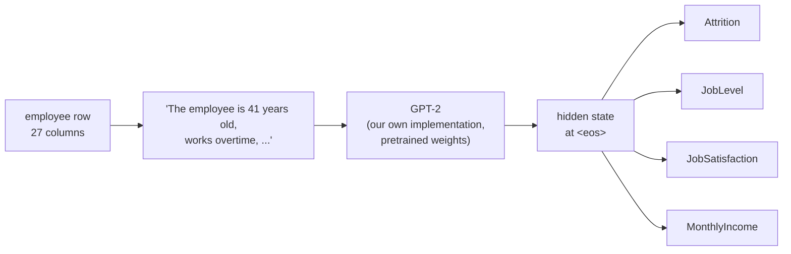
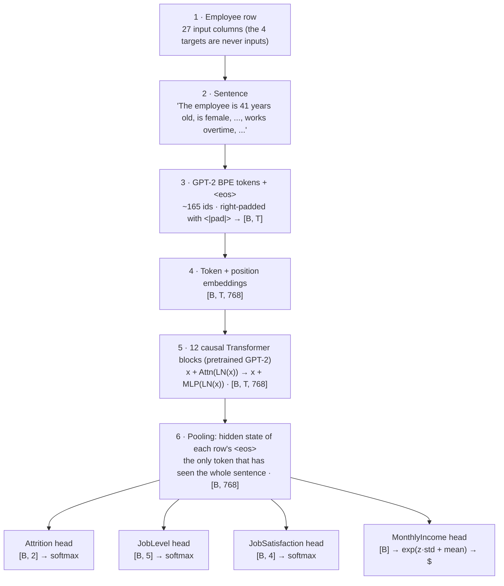

# HR-Jev

**Describe an employee in plain words, get four HR predictions from one GPT-2.**

Named after [Jev](https://docs.typesafe.ai/introduction), TypeSafe AI's "System One" model: like Jev, this model answers with typed decisions (a yes/no probability, a class, a score, a number) instead of generated text.

[](pyproject.toml)
[](https://pytorch.org)
[](https://huggingface.co/openai-community/gpt2)
[](https://www.kaggle.com/datasets/pavansubhasht/ibm-hr-analytics-attrition-dataset)

HR-Jev turns each employee record into an English sentence ("The employee is 41
years old, works overtime, was last promoted 8 years ago, …") and fine-tunes
GPT-2 to read it. Four small heads on the shared Transformer predict:

| Task | Question | Output |
|---|---|---|
| **Attrition** | Will this employee leave? | Stays / Leaves + probability |
| **JobLevel** | Which job level fits this profile? | Level 1 … 5 |
| **JobSatisfaction** | How satisfied are they? | Low … Very High |
| **MonthlyIncome** | What do they earn? | dollars per month |



## Results

**No trained checkpoint is published yet.** Train one with
[the notebook](notebooks/train_colab_kaggle.ipynb) on a free Kaggle or Colab GPU;
it ends with HR-Jev's test results next to these baselines.

The two baselines are already measured on the same 147 test employees, using the
same 27 inputs. They are the bar HR-Jev has to clear:

| Task | Metric | Linear model | Always the majority |
|---|---|---:|---:|
| Attrition | ROC-AUC | 0.853 | 0.500 |
| Attrition | balanced accuracy | 75.3% | 50.0% |
| JobLevel | accuracy | 76.2% | 33.3% |
| JobSatisfaction | balanced accuracy | 21.3% | 25.0% |
| MonthlyIncome | MAE | $1,388 | $3,672 |
| MonthlyIncome | R² | 0.825 | −0.19 |

Two things to know before reading any number:

- **Accuracy is misleading for attrition.** About 84% of employees stay, so always answering
  "stays" is ~84% accurate; the first version's 80.9% was below doing nothing. We report
  balanced accuracy and ROC-AUC.
- **Job satisfaction is not predictable from these columns.** Even the linear model is
  at chance, so expect HR-Jev to be near 25% balanced accuracy too. This is a property
  of the data, not a bug.

See [docs/results.md](docs/results.md).

## How the architecture works

One employee goes through the model like this (GPT-2 small, batch of B employees):



1. **Row → sentence.** `features.py` holds one schema for the 27 input columns:
   their type, allowed values, web-app widget and the phrase each one becomes.
   Training, evaluation and the app all use it, so the model always reads the same
   kind of sentence. The 4 targets are never part of the input.
2. **Why a sentence?** GPT-2 already knows what "works overtime", "Research Director"
   or "was last promoted 8 years ago" mean. With only 1,176 training employees, that
   prior knowledge is the point of using a language model on a table.
3. **Tokens.** GPT-2's tokenizer plus one new `<|pad|>` token. Each sentence ends with
   `<eos>`. Batches are padded *at the end*.
4. **Backbone.** A GPT-2 written from scratch in `model.py` (embeddings, 12 pre-norm
   blocks with causal multi-head attention and a 4× MLP, final LayerNorm). It is
   initialised with OpenAI's GPT-2 weights; a test proves it outputs exactly the same
   hidden states as Hugging Face's GPT-2. The token embedding table (38.6M parameters)
   is frozen; the other 88.2M parameters are fine-tuned.
5. **Pooling.** Attention is causal, so only the last real token (`<eos>`) has seen
   every word. The model reads position `length − 1` of each row, so padding can
   never change a prediction.
6. **Four heads, one pass.** Each head is `Linear(768, 768) → GELU → Dropout →
   Linear(768, k)`. All four read the same vector, so one forward pass answers
   all four questions, and the four tasks train the shared backbone together.

**Loss.** Sum of the four task losses: cross-entropy for the three classifiers
(attrition uses class weights because only 16% of employees leave), and MSE on
standardised `log(income)` for income (incomes range from $1k to $20k and are skewed).
**Optimiser.** AdamW with two learning rates: 3e-5 for the pretrained backbone and
1e-3 for the new heads. Warmup + cosine schedule, gradient clipping, early stopping
on the validation loss.

Details, tensor shapes and the reasons behind each choice are in [docs/architecture.md](docs/architecture.md).


## Quick start

```bash
# 1. install (Python >= 3.10)
python -m venv .venv
source .venv/bin/activate                # Windows: .venv\Scripts\activate
pip install -e '.[app,dev]'

# 2. check everything works (CPU, offline, ~3 min)
pytest

# 3. train (downloads the data and GPT-2 the first time)
hr-train                                 # GPU recommended
hr-train --init distilgpt2               # smaller, better on a CPU

# 4. score it on the test split, next to two baselines
hr-evaluate --checkpoint checkpoints/run/best.pt

# 5. try it in the browser: http://127.0.0.1:7860
hr-app --checkpoint checkpoints/run/best.pt
```

**Recommended:** train on a free Kaggle or Colab GPU with
[the notebook](notebooks/train_colab_kaggle.ipynb), download `hr-jev-model.zip`, then run
step 5 on your computer.

## The web app

Click **🎲 Random test employee** to load someone the model never saw: the
predictions appear next to the true answers (✅ / ❌). Edit any field and click
**Predict** to see what changes. **What the model reads** shows the exact sentence.

## Documentation

| Guide | What is inside |
|---|---|
| [notebooks/train_colab_kaggle.ipynb](notebooks/train_colab_kaggle.ipynb) | **Train on a free Kaggle/Colab GPU**: self-contained, live dashboard, test results, downloadable model |
| [docs/results.md](docs/results.md) | Baselines to beat, how to read the metrics, where to record your results |
| [docs/training.md](docs/training.md) | Install, train (CPU/GPU), outputs, every flag, things to try |
| [docs/inference.md](docs/inference.md) | Web app, `hr-predict`, Python API, evaluation |
| [docs/testing.md](docs/testing.md) | Unit tests and what each one proves, smoke test, web app checklist |
| [docs/architecture.md](docs/architecture.md) | Data, sentence schema, model, losses, training, **what changed from v0.1 and why** |

## Repository layout

```
src/hr_jev/          the package (read in this order)
  features.py        the 27 input columns: UI widgets + the sentence each one becomes
  config.py          tasks, data, model and training settings
  data.py            download, stratified split, targets, tokenizer, dataset, collator
  model.py           GPT-2 from scratch + task heads + loss + GPT-2 weight loading
  metrics.py         accuracy, balanced accuracy, macro-F1, ROC-AUC, MAE, RMSE, R²
  predict.py         Predictor (checkpoint -> predictions) + hr-predict
  train.py           training loop + hr-train
  evaluate.py        test split vs baselines + hr-evaluate
  app.py             Gradio web app + hr-app
notebooks/           Kaggle/Colab notebook + the script that builds it from src/
tests/               pytest suite (CPU, offline)
docs/                guides
```

## Dataset

[IBM HR Analytics Employee Attrition & Performance](https://www.kaggle.com/datasets/pavansubhasht/ibm-hr-analytics-attrition-dataset):
1,470 **fictional** employees created by IBM data scientists, 35 columns.
Downloaded automatically (230 KB, MD5-checked) and split 80/10/10 =
1,176 / 147 / 147, stratified so each split has the same 16% of leavers.

The data is synthetic and small, and includes gender, age and marital status.
This is a learning project: **do not use it to make decisions about real people.**

## Status and next steps

- [x] Single schema for training, inference and the app (fixes a train/app mismatch)
- [x] Multi-task GPT-2 with correct pooling, standardised income target, class balancing
- [x] `hr-train` / `hr-evaluate` / `hr-predict` / `hr-app`, tests, Kaggle/Colab notebook
- [x] Honest evaluation: balanced metrics + logistic/ridge and majority baselines
- [ ] Train GPT-2 on Kaggle/Colab with the notebook and publish the test results
- [ ] Average over several seeds / cross-validation (147 test rows is a small sample)
- [ ] Try LoRA or freezing more layers; try dropping the 3 random "rate" columns
