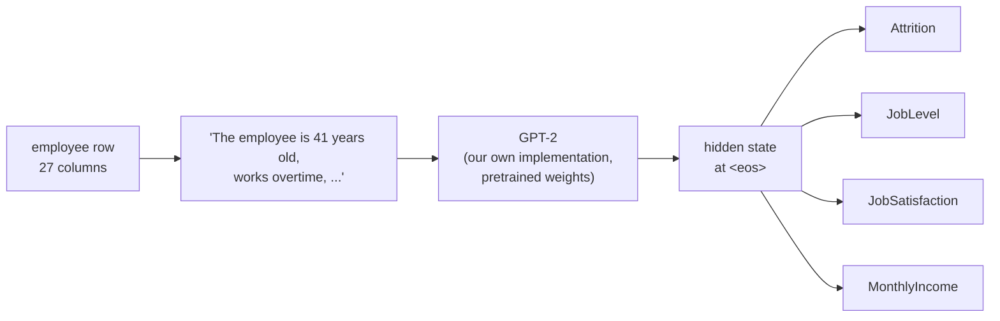
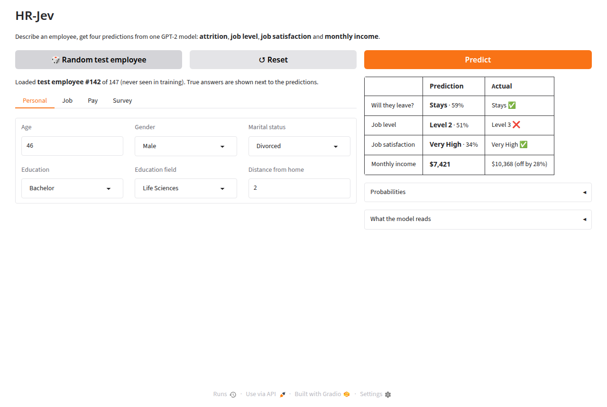
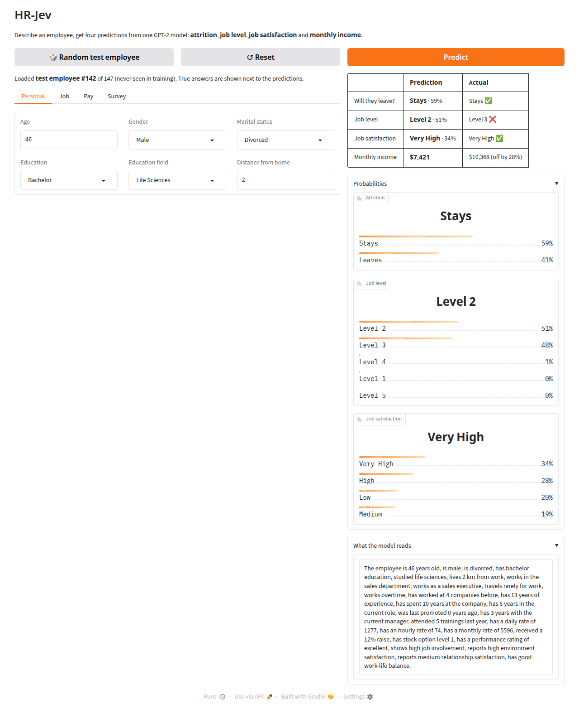
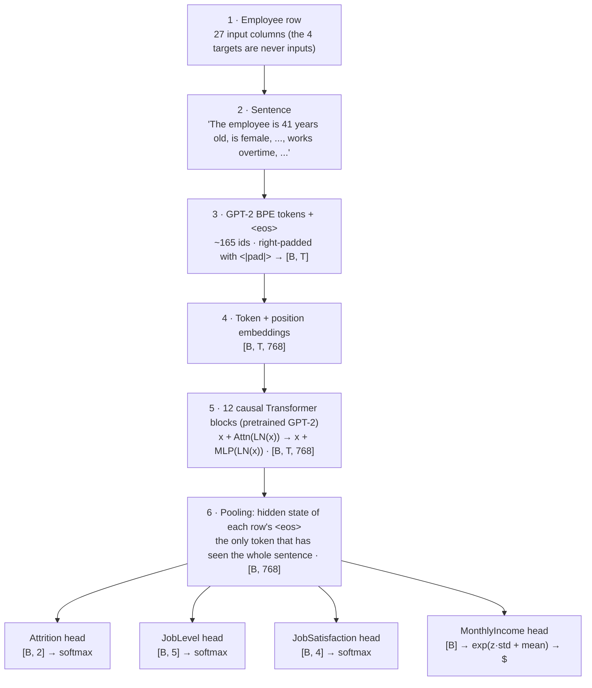

# HR-Jev

**Describe an employee in plain words, get four HR predictions from one GPT-2.**

Named after [Jev](https://docs.typesafe.ai/introduction), TypeSafe AI's "System One" model: like Jev, this model answers with typed decisions (a yes/no probability, a class, a score, a number) instead of generated text.

[](pyproject.toml)
[](https://pytorch.org)
[](https://huggingface.co/openai-community/gpt2)
[](https://www.kaggle.com/datasets/pavansubhasht/ibm-hr-analytics-attrition-dataset)

<p align="center"></p>

HR-Jev turns each employee record into an English sentence ("The employee is 41
years old, works overtime, was last promoted 8 years ago, …") and fine-tunes
GPT-2 to read it. Four small heads on the shared Transformer predict:

| Task | Question | Output |
|---|---|---|
| **Attrition** | Will this employee leave? | Stays / Leaves + probability |
| **JobLevel** | Which job level fits this profile? | Level 1 … 5 |
| **JobSatisfaction** | How satisfied are they? | Low … Very High |
| **MonthlyIncome** | What do they earn? | dollars per month |



## Demo


The web app (`hr-app`, built with Gradio): **🎲 Random test employee** loads one of the 147
employees the model never saw and predicts right away, with the true answers next to the
predictions (✅ / ❌). Edit any field and click **Predict** to see what changes. In the GIF,
switching *Works overtime* moves the leave probability from 22% to 41%.

<details>
<summary>Screenshots</summary>

| A test employee, with the truth | Probabilities + the sentence the model reads |
|---|---|
|  |  |

</details>

### Example predictions

Three employees from the test split, as the model reads them (the model only sees the
sentence; the 4 targets are never in it). The full list of 147 is in
[docs/examples/distilgpt2_test_predictions.csv](docs/examples/distilgpt2_test_predictions.csv)
and more worked examples are in [docs/examples/distilgpt2_report.md](docs/examples/distilgpt2_report.md).

**A leaver the model catches** (test employee #4)

> The employee is 30 years old, is male, is married, has master education, studied life sciences, lives 12 km from work, works in the sales department, works as a sales representative, travels frequently for work, does not work overtime, has worked at 1 company before, has 1 year of experience, has spent 1 year at the company, has 0 years in the current role, was last promoted 0 years ago, has 0 years with the current manager, attended 2 trainings last year, has a daily rate of 448, has an hourly rate of 74, has a monthly rate of 14470, received a 18% raise, has stock option level 1, has a performance rating of excellent, shows medium job involvement, reports medium environment satisfaction, reports high relationship satisfaction, has best work-life balance.

| Task | Prediction | Actual | |
|---|---|---|---|
| Attrition | Leaves (76%) | Leaves | ✅ |
| JobLevel | Level 1 (100%) | Level 1 | ✅ |
| JobSatisfaction | Very High (32%) | Low | ❌ |
| MonthlyIncome | $2,145 | $2,033 | off by 6% |

**A leaver the model misses, confidently** (test employee #144): a 52-year-old sales manager
with 32 years at the company who leaves anyway. Nothing in the record hints at it, and the
model answers like the base rate would.

| Task | Prediction | Actual | |
|---|---|---|---|
| Attrition | Stays (86%) | Leaves | ❌ |
| JobLevel | Level 5 (51%) | Level 5 | ✅ |
| JobSatisfaction | High (32%) | Very High | ❌ |
| MonthlyIncome | $20,084 | $19,845 | off by 1% |

**The largest income error** (test employee #43): a 29-year-old research director with 9 years
of experience earning $16,124. The model reads "29 years old, 9 years of experience" and
predicts a level 3 salary.

| Task | Prediction | Actual | |
|---|---|---|---|
| Attrition | Stays (73%) | Stays | ✅ |
| JobLevel | Level 3 (69%) | Level 4 | ❌ |
| JobSatisfaction | Very High (31%) | Very High | ✅ |
| MonthlyIncome | $9,353 | $16,124 | off by 42% |

Try any of them yourself:

```bash
hr-predict --checkpoint checkpoints/distilgpt2/best.pt --test-row 4 --show-text
```

## Results

Measured on the 147 test employees (never used for training or model selection), with the
same 27 inputs for every model. `hr-evaluate` recomputes all of it.

| Task | Metric | **HR-Jev (DistilGPT-2)** | Linear model | Always the majority |
|---|---|---:|---:|---:|
| Attrition | ROC-AUC | 0.737 | **0.853** | 0.500 |
| Attrition | balanced accuracy | 65.7% | **75.3%** | 50.0% |
| JobLevel | accuracy | 66.0% | **76.2%** | 33.3% |
| JobSatisfaction | balanced accuracy | 22.1% | 21.3% | 25.0% |
| MonthlyIncome | MAE | $1,491 | **$1,388** | $3,672 |
| MonthlyIncome | R² | **0.845** | 0.825 | −0.19 |

*HR-Jev here is `hr-train --init distilgpt2` (6 layers, 82M parameters), 8 epochs, 44 minutes
on an 8-core laptop CPU with no GPU. The checkpoint is 337 MB, so it is not in the repository;
the command above reproduces it (seeded).* The full GPT-2 (12 layers) needs ~5 GB of RAM and
~2 hours on this CPU, or a few minutes on a free Kaggle/Colab GPU with
[the notebook](notebooks/train_colab_kaggle.ipynb); it is the next row to add.


What the numbers say:

- **It learns.** All four heads go from chance at epoch 1 (balanced accuracy 50% / 20% / 25%,
  income R² below zero, i.e. worse than predicting the mean) to useful predictions by epoch 4,
  and the validation loss tracks the training loss: no overfitting in 8 epochs.
- **Income is where the language model shines**: R² 0.845 and RMSE $1,955 beat the ridge
  baseline (0.825 / $2,076). The scatter plot below shows the few large misses are all
  high-level roles with little experience.
- **Attrition and job level: the model finds leavers** (12 of the 24 test leavers, versus 0
  for "always stays") but is behind the class-balanced logistic regression on both tasks. With
  1,176 training rows a linear model on clean one-hot features is hard to beat, and this
  run was stopped at the default 8 epochs.
- **Job satisfaction is noise**, as the baselines predicted: the model only ever answers
  "High" or "Very High" and lands at chance. That is a property of this dataset, not a bug.
- **Accuracy is misleading for attrition.** About 84% of employees stay, so "always stays"
  is 83.7% accurate while finding nobody; look at ROC-AUC and balanced accuracy.

<p align="center"></p>

Full tables, confusion matrices and worked examples: [docs/examples/distilgpt2_report.md](docs/examples/distilgpt2_report.md).
How to read the metrics and the baselines: [docs/results.md](docs/results.md).

## How the architecture works

One employee goes through the model like this (GPT-2 small, batch of B employees):



1. **Row → sentence.** `features.py` holds one schema for the 27 input columns:
   their type, allowed values, web-app widget and the phrase each one becomes.
   Training, evaluation and the app all use it, so the model always reads the same
   kind of sentence. The 4 targets are never part of the input.
2. **Why a sentence?** GPT-2 already knows what "works overtime", "Research Director"
   or "was last promoted 8 years ago" mean. With only 1,176 training employees, that
   prior knowledge is the point of using a language model on a table.
3. **Tokens.** GPT-2's tokenizer plus one new `<|pad|>` token. Each sentence ends with
   `<eos>`. Batches are padded *at the end*.
4. **Backbone.** A GPT-2 written from scratch in `model.py` (embeddings, 12 pre-norm
   blocks with causal multi-head attention and a 4× MLP, final LayerNorm). It is
   initialised with OpenAI's GPT-2 weights; a test proves it outputs exactly the same
   hidden states as Hugging Face's GPT-2. The token embedding table (38.6M parameters)
   is frozen; the other 88.2M parameters are fine-tuned.
5. **Pooling.** Attention is causal, so only the last real token (`<eos>`) has seen
   every word. The model reads position `length − 1` of each row, so padding can
   never change a prediction.
6. **Four heads, one pass.** Each head is `Linear(768, 768) → GELU → Dropout →
   Linear(768, k)`. All four read the same vector, so one forward pass answers
   all four questions, and the four tasks train the shared backbone together.

**Loss.** Sum of the four task losses: cross-entropy for the three classifiers
(attrition uses class weights because only 16% of employees leave), and MSE on
standardised `log(income)` for income (incomes range from $1k to $20k and are skewed).
**Optimiser.** AdamW with two learning rates: 3e-5 for the pretrained backbone and
1e-3 for the new heads. Warmup + cosine schedule, gradient clipping, early stopping
on the validation loss.

Details, tensor shapes and the reasons behind each choice are in [docs/architecture.md](docs/architecture.md).


## Quick start

```bash
# 1. install (Python >= 3.10)
python -m venv .venv
source .venv/bin/activate                # Windows: .venv\Scripts\activate
pip install -e '.[app,dev]'

# 2. check everything works (CPU, offline, ~3 min)
pytest

# 3. train (downloads the data and GPT-2 the first time)
hr-train                                 # GPU recommended
hr-train --init distilgpt2               # smaller, better on a CPU

# 4. score it on the test split, next to two baselines
hr-evaluate --checkpoint checkpoints/run/best.pt

# 5. try it in the browser: http://127.0.0.1:7860
hr-app --checkpoint checkpoints/run/best.pt
```

**Recommended:** train on a free Kaggle or Colab GPU with
[the notebook](notebooks/train_colab_kaggle.ipynb), download `hr-jev-model.zip`, then run
step 5 on your computer.

## The web app

See the [Demo](#demo) above. `hr-app --checkpoint <best.pt>` starts it at http://127.0.0.1:7860;
`--share` gives a temporary public link. The clicks in the GIF are scripted in
`scripts/capture_demo.py` (Playwright), which also takes the screenshots.

## Documentation

| Guide | What is inside |
|---|---|
| [notebooks/train_colab_kaggle.ipynb](notebooks/train_colab_kaggle.ipynb) | **Train on a free Kaggle/Colab GPU**: self-contained, live dashboard, test results, downloadable model |
| [docs/examples/distilgpt2_report.md](docs/examples/distilgpt2_report.md) | **Measured results**: curves, test tables vs baselines, confusion matrices, worked examples (hits and misses) |
| [docs/results.md](docs/results.md) | Baselines, how to read the metrics, how the results were produced |
| [docs/training.md](docs/training.md) | Install, train (CPU/GPU), outputs, every flag, things to try |
| [docs/inference.md](docs/inference.md) | Web app, `hr-predict`, Python API, evaluation |
| [docs/testing.md](docs/testing.md) | Unit tests and what each one proves, smoke test, web app checklist |
| [docs/architecture.md](docs/architecture.md) | Data, sentence schema, model, losses, training, **what changed from v0.1 and why** |

## Repository layout

```
src/hr_jev/          the package (read in this order)
  features.py        the 27 input columns: UI widgets + the sentence each one becomes
  config.py          tasks, data, model and training settings
  data.py            download, stratified split, targets, tokenizer, dataset, collator
  model.py           GPT-2 from scratch + task heads + loss + GPT-2 weight loading
  metrics.py         accuracy, balanced accuracy, macro-F1, ROC-AUC, MAE, RMSE, R²
  predict.py         Predictor (checkpoint -> predictions) + hr-predict
  train.py           training loop + hr-train
  evaluate.py        test split vs baselines + hr-evaluate
  app.py             Gradio web app + hr-app
notebooks/           Kaggle/Colab notebook + the script that builds it from src/
scripts/             make_report.py (curves, tables, examples) · capture_demo.py (screenshots, GIF)
tests/               pytest suite (CPU, offline)
docs/                guides · examples/ (reports, per-row predictions) · images/
```

## Dataset

[IBM HR Analytics Employee Attrition & Performance](https://www.kaggle.com/datasets/pavansubhasht/ibm-hr-analytics-attrition-dataset):
1,470 **fictional** employees created by IBM data scientists, 35 columns.
Downloaded automatically (230 KB, MD5-checked) and split 80/10/10 =
1,176 / 147 / 147, stratified so each split has the same 16% of leavers.

The data is synthetic and small, and includes gender, age and marital status.
This is a learning project: **do not use it to make decisions about real people.**

## Status and next steps

- [x] Single schema for training, inference and the app (fixes a train/app mismatch)
- [x] Multi-task GPT-2 with correct pooling, standardised income target, class balancing
- [x] `hr-train` / `hr-evaluate` / `hr-predict` / `hr-app`, tests, Kaggle/Colab notebook
- [x] Honest evaluation: balanced metrics + logistic/ridge and majority baselines
- [x] Train and publish test results, curves, examples and a demo (DistilGPT-2, CPU)
- [ ] Add the full GPT-2 run to the results table; publish the checkpoints (Hugging Face Hub)
- [ ] Average over several seeds / cross-validation (147 test rows is a small sample)
- [ ] Try LoRA or freezing more layers; try dropping the 3 random "rate" columns
