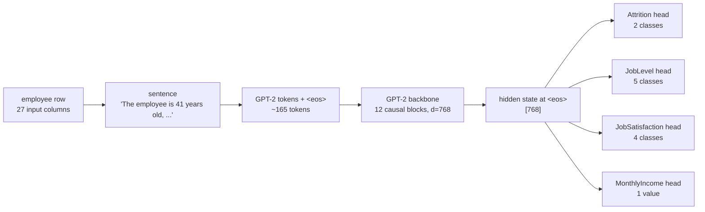

# How HR-LLM works

## The idea

A table row is turned into an English sentence, and a pretrained language model
reads it. GPT-2 already knows what "works overtime", "Research Director" or
"was last promoted 8 years ago" mean, so it does not have to learn the meaning of
every column from 1,176 training rows. Four small heads on top of one shared
Transformer turn its reading into four answers.



## Data

[IBM HR Analytics Employee Attrition & Performance](https://www.kaggle.com/datasets/pavansubhasht/ibm-hr-analytics-attrition-dataset)
is a **fictional** dataset created by IBM data scientists: 1,470 employees, 35
columns. `hr_llm.data.prepare_data` downloads it once
([mirror in IBM's GitHub](https://github.com/IBM/employee-attrition-aif360), MD5
checked), then:

1. drops 4 useless columns (`EmployeeCount`, `Over18`, `StandardHours` are constant,
   `EmployeeNumber` is an ID);
2. checks every expected column is present and nothing is missing;
3. splits **80 / 10 / 10** (1,176 / 147 / 147), **stratified on Attrition** so each
   split has the same 16% of leavers, with a fixed seed;
4. writes `data/processed/{train,val,test}.csv` with the CSV's own values.

### One schema for everything

`src/hr_llm/features.py` lists the 27 input columns once: their label and tab in
the web app, their allowed values or range, their default, and the phrase they
become in the sentence. Training, evaluation, `hr-predict` and the web app all use
it, so a record always turns into **exactly the same sentence**.

```
Age=41, Gender=Female, OverTime=Yes, Education=2, PerformanceRating=3, ...
-> "The employee is 41 years old, is female, ..., has college education, ...,
    works overtime, ..., has a performance rating of excellent, ..."
```

### Targets

| Task | Kind | Classes / output | Loss |
|---|---|---|---|
| Attrition | binary | Stays, Leaves | cross-entropy, **class-balanced** (leavers are 16%) |
| JobLevel | 5 classes | Level 1 … Level 5 | cross-entropy |
| JobSatisfaction | 4 classes | Low, Medium, High, Very High | cross-entropy |
| MonthlyIncome | regression | dollars per month | MSE on **standardised log(income)** |

Income goes from $1,009 to $19,999 and is right-skewed, so the head predicts
`z = (log(income) − mean) / std`, with mean and std measured on the training split
and saved in the checkpoint. The answer is turned back into dollars with
`exp(z · std + mean)`.

The four targets are **never** in the input sentence. Every task reads the same
sentence, so one forward pass answers all four.

## Model

`src/hr_llm/model.py` is a from-scratch GPT-2 (no Hugging Face model classes in
the forward pass):

- token + position embeddings, dropout
- N pre-norm blocks: `x + attn(ln(x))`, `x + mlp(ln(x))`, causal multi-head
  attention (`F.scaled_dot_product_attention`, FlashAttention when available),
  MLP 4× wide with tanh-GELU
- final LayerNorm
- **pooling:** the hidden state of the last real token (`<eos>`). Attention is
  causal, so `<eos>` is the only position that has seen the whole sentence.
  Batches are right-padded and the model reads position `length − 1` of each row,
  so padding can never change a prediction (a test checks this).
- one head per task: `Linear(768, 768) → GELU → Dropout → Linear(768, n_outputs)`

| init | layers | d | heads | parameters | trainable (embeddings frozen) |
|---|---:|---:|---:|---:|---:|
| `gpt2` (default) | 12 | 768 | 12 | 126.8M | 88.2M |
| `distilgpt2` | 6 | 768 | 12 | 84.3M | 45.7M |
| `scratch` | your choice | | | | |

### Loading GPT-2 weights

`load_pretrained_backbone` copies GPT-2 (or DistilGPT-2) from the Hugging Face
hub into our modules. Hugging Face stores attention and MLP matrices as `Conv1D`
(`[in, out]`) and ours are `nn.Linear` (`[out, in]`), so those four kinds of
matrices are transposed. The extra `<|pad|>` embedding row is set to the mean
embedding. A test loads a random Hugging Face GPT-2 this way and checks our hidden
states match its hidden states to 1e-5: the mapping and our blocks are exactly GPT-2.

## Training

- AdamW with **two learning rates**: 3e-5 for the pretrained backbone (small, so it
  does not forget what it knows), 1e-3 for the new heads; weight decay 0.01 on
  matrices only
- the token embedding table (38.6M parameters) is **frozen** by default:
  with 1.2k sentences there is nothing to gain from moving it, and it saves memory
- linear warmup (10% of steps) then cosine decay to 0; gradient clipping at 1.0
- loss = sum of the four task losses (weights in `TaskSpec.loss_weight`)
- validation after each epoch; `best.pt` keeps the lowest validation loss; early
  stop after 3 epochs without improvement
- bf16 autocast on GPUs that support it, fp32 elsewhere (no fp16: no loss scaling to
  get wrong)

## What changed from the first version

| Before | Problem | Now |
|---|---|---|
| Ordinal codes (Education, satisfaction, performance, work-life balance) mapped as 0-based | The CSV is 1-based: "Below College" was written "college", rating 3 "Excellent" became "outstanding". The app used 0-based labels, so **training and the app wrote different sentences for the same employee** | One schema with the CSV's real codes, used everywhere |
| Each task's sentence contained the other three targets | JobLevel was given to predict MonthlyIncome; Attrition (an outcome) was given to predict JobSatisfaction. The app had no fields for them, so the model saw inputs at inference that it never had in training | Targets are never inputs; one forward pass answers all four tasks |
| Hidden state read at position −1 | That is a pad token for every row shorter than the longest in its batch | Read at each row's real last token |
| Income target = dollars / 1000, loss × 10, classification loss × 0.1, scale clamp | Huge gradients (the inf/NaN and "regression takes huge numbers" issues in the commit log), and classification was almost switched off | Standardised log income + MSE, every task weighted 1 |
| Attention dropout used `resid_pdrop` | wrong dropout value | `config.dropout` |
| Weight init looped over all parameters for every module | O(n²) startup | one pass |
| `TrainConfig.validate` read `self.batch_size` (not a field) | crashed if called | fixed, and called |
| Accuracy only | 80.9% attrition accuracy is **worse** than always answering "stays" (~84%) | balanced accuracy, macro-F1, ROC-AUC, MAE, R², and two baselines |
| Hard-coded checkpoint paths in scripts | | `hr-train`, `hr-evaluate`, `hr-predict`, `hr-app` commands with flags |
