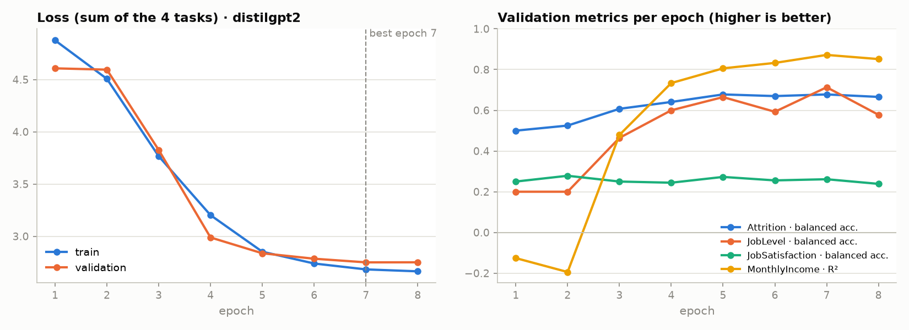
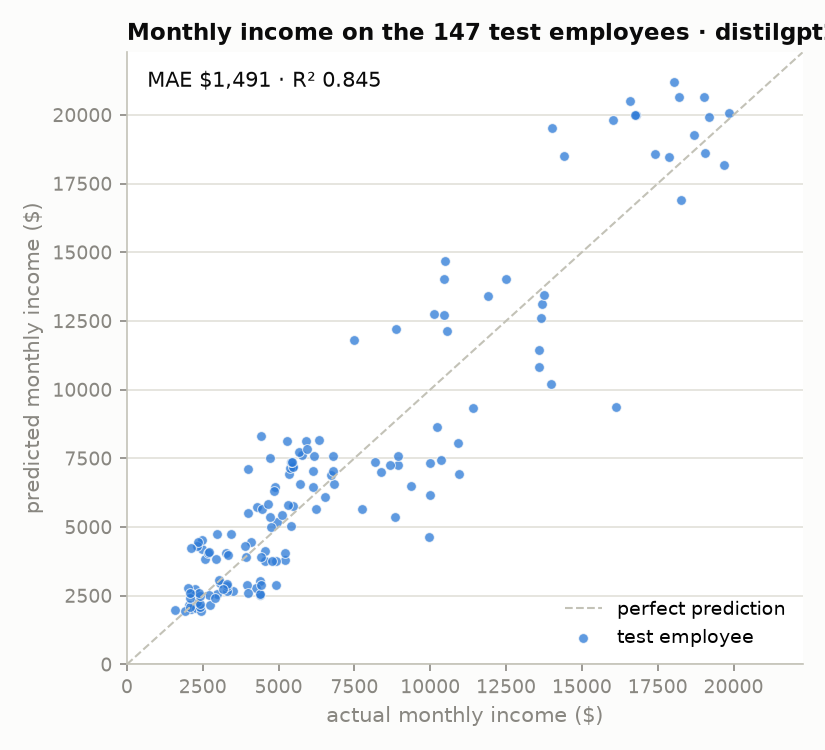

# HR-Jev results · `distilgpt2`

Checkpoint `checkpoints/distilgpt2/best.pt`: lowest validation loss at epoch 7 of 8, 44 min of training on an 8-core laptop CPU, no GPU.
Generated by `python scripts/make_report.py`; every number below is reproducible with
`hr-evaluate --checkpoint checkpoints/distilgpt2/best.pt`.

## Training curves

| epoch | train loss | val loss | Attrition bal. acc. | Attrition AUC | JobLevel acc. | JobSatisfaction bal. acc. | Income MAE | Income R² |
|---:|---:|---:|---:|---:|---:|---:|---:|---:|
| 1 | 4.875 | 4.607 | 50.0% | 0.521 | 40.1% | 25.0% | $3,434 | -0.126 |
| 2 | 4.507 | 4.595 | 52.5% | 0.581 | 40.1% | 27.8% | $3,466 | -0.194 |
| 3 | 3.766 | 3.826 | 60.7% | 0.633 | 51.7% | 25.0% | $2,444 | 0.479 |
| 4 | 3.202 | 2.988 | 64.1% | 0.643 | 67.3% | 24.4% | $1,743 | 0.734 |
| 5 | 2.852 | 2.837 | 67.8% | 0.674 | 71.4% | 27.3% | $1,477 | 0.806 |
| 6 | 2.739 | 2.785 | 67.0% | 0.681 | 68.0% | 25.6% | $1,389 | 0.833 |
| 7 ★ | 2.683 | 2.750 | 67.8% | 0.687 | 72.1% | 26.1% | $1,276 | 0.872 |
| 8 | 2.664 | 2.751 | 66.6% | 0.688 | 66.7% | 23.9% | $1,357 | 0.851 |

★ = epoch saved as `best.pt` (lowest validation loss). An income R² below zero means the head is still worse than predicting the mean income (R² = 1 − model error / mean error).

## Test split: HR-Jev vs the baselines

Test split: 147 employees never seen in training.

**Attrition**

| metric | HR-Jev | linear baseline | trivial baseline |
|---|---:|---:|---:|
| accuracy | 76.2% | 75.5% | 83.7% |
| balanced acc. | 65.7% | 75.3% | 50.0% |
| macro-F1 | 0.629 | 0.669 | 0.456 |
| ROC-AUC | 0.737 | 0.853 | 0.500 |

**JobLevel**

| metric | HR-Jev | linear baseline | trivial baseline |
|---|---:|---:|---:|
| accuracy | 66.0% | 76.2% | 33.3% |
| balanced acc. | 53.5% | 63.8% | 20.0% |
| macro-F1 | 0.508 | 0.639 | 0.100 |

**JobSatisfaction**

| metric | HR-Jev | linear baseline | trivial baseline |
|---|---:|---:|---:|
| accuracy | 26.5% | 24.5% | 36.1% |
| balanced acc. | 22.1% | 21.3% | 25.0% |
| macro-F1 | 0.164 | 0.190 | 0.133 |

**MonthlyIncome**

| metric | HR-Jev | linear baseline | trivial baseline |
|---|---:|---:|---:|
| MAE | $1,491 | $1,388 | $3,672 |
| RMSE | $1,955 | $2,076 | $5,418 |
| R² | 0.845 | 0.825 | -0.191 |

## Confusion matrices (test split)

**Attrition**

| actual \ predicted | Stays | Leaves |
|---|---:|---:|
| Stays | **100** | 23 |
| Leaves | 12 | **12** |

**JobLevel**

| actual \ predicted | Level 1 | Level 2 | Level 3 | Level 4 | Level 5 |
|---|---:|---:|---:|---:|---:|
| Level 1 | **38** | 11 | 0 | 0 | 0 |
| Level 2 | 2 | **45** | 9 | 0 | 0 |
| Level 3 | 0 | 6 | **7** | 9 | 0 |
| Level 4 | 0 | 0 | 3 | **0** | 8 |
| Level 5 | 0 | 0 | 0 | 2 | **7** |

**JobSatisfaction**

| actual \ predicted | Low | Medium | High | Very High |
|---|---:|---:|---:|---:|
| Low | **0** | 0 | 18 | 16 |
| Medium | 0 | **0** | 14 | 8 |
| High | 0 | 0 | **20** | 18 |
| Very High | 0 | 0 | 34 | **19** |

## Monthly income: predicted vs actual

## Worked examples

Every row of the test split, with the sentence the model read, its four predictions and
the truth, is in [`distilgpt2_test_predictions.csv`](distilgpt2_test_predictions.csv).
A few of them, chosen to show what works and what does not:

### Where everything is right

**Test employee #7** · what the model reads:

> The employee is 25 years old, is male, is single, has master education, studied life sciences, lives 10 km from work, works in the sales department, works as a sales executive, travels rarely for work, does not work overtime, has worked at 0 companies before, has 5 years of experience, has spent 4 years at the company, has 3 years in the current role, was last promoted 1 year ago, has 1 year with the current manager, attended 4 trainings last year, has a daily rate of 1356, has an hourly rate of 57, has a monthly rate of 20623, received a 14% raise, has stock option level 0, has a performance rating of excellent, shows high job involvement, reports high environment satisfaction, reports medium relationship satisfaction, has better work-life balance.

| Task | Prediction | Actual | |
|---|---|---|---|
| Attrition | Stays (55%) | Stays | ✅ |
| JobLevel | Level 2 (92%) | Level 2 | ✅ |
| JobSatisfaction | Very High (31%) | Very High | ✅ |
| MonthlyIncome | $5,170 | $4,950 | off by 4% |

**Test employee #31** · what the model reads:

> The employee is 43 years old, is female, is single, has bachelor education, studied medical, lives 6 km from work, works in the research & development department, works as a research scientist, travels rarely for work, works overtime, has worked at 1 company before, has 20 years of experience, has spent 20 years at the company, has 7 years in the current role, was last promoted 1 year ago, has 8 years with the current manager, attended 3 trainings last year, has a daily rate of 930, has an hourly rate of 73, has a monthly rate of 20003, received a 14% raise, has stock option level 0, has a performance rating of excellent, shows medium job involvement, reports low environment satisfaction, reports low relationship satisfaction, has bad work-life balance.

| Task | Prediction | Actual | |
|---|---|---|---|
| Attrition | Stays (65%) | Stays | ✅ |
| JobLevel | Level 2 (82%) | Level 2 | ✅ |
| JobSatisfaction | High (32%) | High | ✅ |
| MonthlyIncome | $4,454 | $4,081 | off by 9% |

**Test employee #32** · what the model reads:

> The employee is 32 years old, is male, is single, has doctor education, studied life sciences, lives 6 km from work, works in the research & development department, works as a research scientist, travels rarely for work, does not work overtime, has worked at 3 companies before, has 8 years of experience, has spent 5 years at the company, has 4 years in the current role, was last promoted 1 year ago, has 4 years with the current manager, attended 2 trainings last year, has a daily rate of 120, has an hourly rate of 43, has a monthly rate of 12430, received a 20% raise, has stock option level 0, has a performance rating of outstanding, shows high job involvement, reports high environment satisfaction, reports low relationship satisfaction, has better work-life balance.

| Task | Prediction | Actual | |
|---|---|---|---|
| Attrition | Stays (51%) | Stays | ✅ |
| JobLevel | Level 1 (96%) | Level 1 | ✅ |
| JobSatisfaction | High (31%) | High | ✅ |
| MonthlyIncome | $3,074 | $3,038 | off by 1% |

**Test employee #34** · what the model reads:

> The employee is 26 years old, is male, is married, has college education, studied medical, lives 2 km from work, works in the research & development department, works as a manufacturing director, travels rarely for work, does not work overtime, has worked at 1 company before, has 8 years of experience, has spent 8 years at the company, has 7 years in the current role, was last promoted 1 year ago, has 3 years with the current manager, attended 2 trainings last year, has a daily rate of 1066, has an hourly rate of 32, has a monthly rate of 3334, received a 12% raise, has stock option level 0, has a performance rating of excellent, shows very high job involvement, reports very high environment satisfaction, reports medium relationship satisfaction, has better work-life balance.

| Task | Prediction | Actual | |
|---|---|---|---|
| Attrition | Stays (64%) | Stays | ✅ |
| JobLevel | Level 2 (88%) | Level 2 | ✅ |
| JobSatisfaction | Very High (31%) | Very High | ✅ |
| MonthlyIncome | $5,764 | $5,472 | off by 5% |

### Leavers the model caught

**Test employee #4** · what the model reads:

> The employee is 30 years old, is male, is married, has master education, studied life sciences, lives 12 km from work, works in the sales department, works as a sales representative, travels frequently for work, does not work overtime, has worked at 1 company before, has 1 year of experience, has spent 1 year at the company, has 0 years in the current role, was last promoted 0 years ago, has 0 years with the current manager, attended 2 trainings last year, has a daily rate of 448, has an hourly rate of 74, has a monthly rate of 14470, received a 18% raise, has stock option level 1, has a performance rating of excellent, shows medium job involvement, reports medium environment satisfaction, reports high relationship satisfaction, has best work-life balance.

| Task | Prediction | Actual | |
|---|---|---|---|
| Attrition | Leaves (76%) | Leaves | ✅ |
| JobLevel | Level 1 (100%) | Level 1 | ✅ |
| JobSatisfaction | Very High (32%) | Low | ❌ |
| MonthlyIncome | $2,145 | $2,033 | off by 6% |

**Test employee #8** · what the model reads:

> The employee is 19 years old, is male, is single, has bachelor education, studied other, lives 21 km from work, works in the sales department, works as a sales representative, travels rarely for work, works overtime, has worked at 1 company before, has 1 year of experience, has spent 1 year at the company, has 0 years in the current role, was last promoted 0 years ago, has 0 years with the current manager, attended 3 trainings last year, has a daily rate of 419, has an hourly rate of 37, has a monthly rate of 9947, received a 13% raise, has stock option level 0, has a performance rating of excellent, shows medium job involvement, reports very high environment satisfaction, reports medium relationship satisfaction, has best work-life balance.

| Task | Prediction | Actual | |
|---|---|---|---|
| Attrition | Leaves (81%) | Leaves | ✅ |
| JobLevel | Level 1 (100%) | Level 1 | ✅ |
| JobSatisfaction | Very High (32%) | Medium | ❌ |
| MonthlyIncome | $2,014 | $2,121 | off by 5% |

### Attrition mistakes (the most confident ones)

**Test employee #144** · what the model reads:

> The employee is 52 years old, is female, is married, has below college education, studied marketing, lives 2 km from work, works in the sales department, works as a manager, travels rarely for work, does not work overtime, has worked at 1 company before, has 33 years of experience, has spent 32 years at the company, has 14 years in the current role, was last promoted 6 years ago, has 9 years with the current manager, attended 3 trainings last year, has a daily rate of 266, has an hourly rate of 57, has a monthly rate of 25846, received a 15% raise, has stock option level 1, has a performance rating of excellent, shows low job involvement, reports low environment satisfaction, reports very high relationship satisfaction, has better work-life balance.

| Task | Prediction | Actual | |
|---|---|---|---|
| Attrition | Stays (86%) | Leaves | ❌ |
| JobLevel | Level 5 (51%) | Level 5 | ✅ |
| JobSatisfaction | High (32%) | Very High | ❌ |
| MonthlyIncome | $20,084 | $19,845 | off by 1% |

**Test employee #71** · what the model reads:

> The employee is 46 years old, is female, is married, has college education, studied medical, lives 21 km from work, works in the research & development department, works as a healthcare representative, travels rarely for work, does not work overtime, has worked at 4 companies before, has 13 years of experience, has spent 9 years at the company, has 7 years in the current role, was last promoted 3 years ago, has 7 years with the current manager, attended 2 trainings last year, has a daily rate of 261, has an hourly rate of 66, has a monthly rate of 10842, received a 22% raise, has stock option level 1, has a performance rating of outstanding, shows high job involvement, reports very high environment satisfaction, reports very high relationship satisfaction, has best work-life balance.

| Task | Prediction | Actual | |
|---|---|---|---|
| Attrition | Stays (74%) | Leaves | ❌ |
| JobLevel | Level 2 (54%) | Level 2 | ✅ |
| JobSatisfaction | High (32%) | Medium | ❌ |
| MonthlyIncome | $7,252 | $8,926 | off by 19% |

**Test employee #95** · what the model reads:

> The employee is 35 years old, is male, is married, has below college education, studied life sciences, lives 7 km from work, works in the sales department, works as a sales representative, travels rarely for work, does not work overtime, has worked at 1 company before, has 1 year of experience, has spent 1 year at the company, has 0 years in the current role, was last promoted 0 years ago, has 0 years with the current manager, attended 3 trainings last year, has a daily rate of 660, has an hourly rate of 76, has a monthly rate of 16192, received a 13% raise, has stock option level 1, has a performance rating of excellent, shows high job involvement, reports very high environment satisfaction, reports low relationship satisfaction, has better work-life balance.

| Task | Prediction | Actual | |
|---|---|---|---|
| Attrition | Leaves (74%) | Stays | ❌ |
| JobLevel | Level 1 (100%) | Level 1 | ✅ |
| JobSatisfaction | Very High (31%) | High | ❌ |
| MonthlyIncome | $2,192 | $2,404 | off by 9% |

**Test employee #75** · what the model reads:

> The employee is 51 years old, is male, is married, has bachelor education, studied life sciences, lives 1 km from work, works in the research & development department, works as a research scientist, travels rarely for work, does not work overtime, has worked at 1 company before, has 1 year of experience, has spent 1 year at the company, has 0 years in the current role, was last promoted 0 years ago, has 0 years with the current manager, attended 0 trainings last year, has a daily rate of 833, has an hourly rate of 96, has a monthly rate of 23231, received a 11% raise, has stock option level 0, has a performance rating of excellent, shows high job involvement, reports high environment satisfaction, reports medium relationship satisfaction, has good work-life balance.

| Task | Prediction | Actual | |
|---|---|---|---|
| Attrition | Leaves (73%) | Stays | ❌ |
| JobLevel | Level 1 (100%) | Level 1 | ✅ |
| JobSatisfaction | High (30%) | Very High | ❌ |
| MonthlyIncome | $2,144 | $2,723 | off by 21% |

### Largest income errors

**Test employee #43** · what the model reads:

> The employee is 29 years old, is female, is divorced, has bachelor education, studied life sciences, lives 1 km from work, works in the research & development department, works as a research director, travels rarely for work, does not work overtime, has worked at 3 companies before, has 9 years of experience, has spent 7 years at the company, has 7 years in the current role, was last promoted 1 year ago, has 7 years with the current manager, attended 2 trainings last year, has a daily rate of 694, has an hourly rate of 87, has a monthly rate of 3423, received a 14% raise, has stock option level 2, has a performance rating of excellent, shows medium job involvement, reports very high environment satisfaction, reports medium relationship satisfaction, has good work-life balance.

| Task | Prediction | Actual | |
|---|---|---|---|
| Attrition | Stays (73%) | Stays | ✅ |
| JobLevel | Level 3 (69%) | Level 4 | ❌ |
| JobSatisfaction | Very High (31%) | Very High | ✅ |
| MonthlyIncome | $9,353 | $16,124 | off by 42% |

**Test employee #103** · what the model reads:

> The employee is 51 years old, is male, is divorced, has bachelor education, studied life sciences, lives 5 km from work, works in the human resources department, works as a manager, travels rarely for work, works overtime, has worked at 1 company before, has 33 years of experience, has spent 33 years at the company, has 9 years in the current role, was last promoted 0 years ago, has 10 years with the current manager, attended 2 trainings last year, has a daily rate of 770, has an hourly rate of 84, has a monthly rate of 17588, received a 11% raise, has stock option level 1, has a performance rating of excellent, shows high job involvement, reports high environment satisfaction, reports medium relationship satisfaction, has better work-life balance.

| Task | Prediction | Actual | |
|---|---|---|---|
| Attrition | Stays (86%) | Stays | ✅ |
| JobLevel | Level 5 (51%) | Level 4 | ❌ |
| JobSatisfaction | High (32%) | Medium | ❌ |
| MonthlyIncome | $19,513 | $14,026 | off by 39% |
